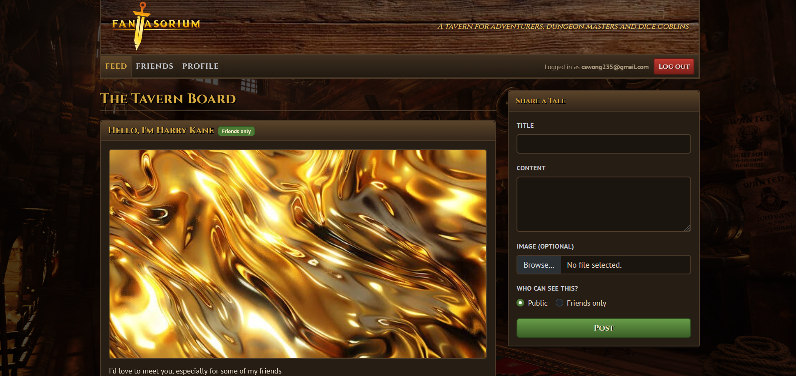

# 

A project built to let people create posts and befriend one another.

Features include:
- Login and registration with Supabase Auth
- OAuth support to allow registration or logging in via Google
- Create public or friends-only posts
- Infinitely scrolling feed
- User search to find users to befriend
- Friends list and unfriending
- User profile page

Built with:
- JavaScript (ES6)
- PostgreSQL
- React
- HTML
- CSS
- Bootstrap

Deployed with:
- Vercel: For frontend and backend service
  - Backend service can be found here: https://github.com/cswong235/fantasorium-backend
- Supabase: For database hosting

## Links
- Vercel link: https://fantasorium-frontend-bzo097jik-cs-wong.vercel.app/
